

## Graphical Environment Management System Overview

Travis L. Seymour, PhD 2021-2026

### Goal

Create interactive virtual environments defined by a series of static
images and various interactions and dynamics.

### GEMSedit

The editor allows one to create or edit GEMS environments. Environments
are made of a **_views_**, which is a viewpoint onto anything that can
be depicted. E.g, a view might depict a doorway, or what it looks like
inside a room. It might also depict a closeup of an object, or a
depiction of what it’s like inside that object. It can literally be
anything that one can create an image of, including a bunch of text if
you want – although that might not be too exciting. To define an
environment, photograph, draw, or otherwise create or obtain an image
that corresponds to all the views you want to exist within the
environment and stitch them together using GEMSedit. Another
important thing one does with GEMSedit is to define **_objects,_**
which are sub-regions of view images that can be either rectangular or
irregular polygon shapes. Although typically,
objects specify meaningful objects that are depicted in the view images
(e.g., a book, a cup, or a door), objects may also define areas or
sub-areas of a view image not necessarily tied to specific physical
objects within that view (e.g., a doorway, a hallway, the left side of a
room, or the top of a painting). Last, but not least, GEMSedit is
used to definite various environmental actions, interactions, and
consequences of those actions or interactions.

**Actions**. Actions are events that can occur in the environment as a
result of some action and optionally if some condition is met. For
example, you could specify that a sound effect (the **_action_**) if the
user left-clicks (the **_trigger_**) the mouse on a previously defined
object (the **_target object_**). Some actions are environmental, e.g.,
the passage of a certain amount of time, and others are based on user
actions (keyboard presses or mouse actions). Although user actions are
typically with regard to user-defined objects within some view, there
are special navigational actions as well. For example, you can define
what happens when the user clicks the left edge of the screen, e.g., you
might be taken to a new view. Objects with actions that lead to a view
change are called **_portals_**, and are typically in regard to some
user defined objects. But the left and right side of the screen are
special implicit objects one can design as triggers for some actions.
Although they are customarily used to allow the users to turn left or
right within some implied space, they don’t have to be used this way.

**Interactions**. Interactions are really just normal actions that
trigger as a result of one object being dragged (using the mouse
left-button) onto another object. This is a great way to increase the
richness of actions in the environment. For example, one could drag a
key object onto a locked door. This door could be specified to open or
portal to another view if clicked on **<u>after</u>** it has had the key
dropped onto it. Of course, this would require the environment to be
able to keep track of such occurrences. This is one of the uses for
**_variables_** within GEMS. An interaction like dragging a key onto a
door might result in setting the value of a new variable called
“door_unlocked” to True. Clicking the door could be set up to open (i.e,
portal to another view) if and only if there exists a variable called
“door_unlocked” that currently has the value True.

All actions have 3 required parts and 1 optional parts:

- **Trigger**. These define the event (environmental or user-action)
  that is required before an action will fire. An example of one
  environmental trigger is **TotalTimePassed**(_Seconds_) : This trigger
  fires when at least \<_Seconds_> seconds has passed since the current
  GEMS environment was started. An example of a user-action trigger is
  **MouseClick**() : This trigger fires whenever the mouse is
  left-clicked.

- **Action**. These define the action that occurs when a trigger occurs.
  For example, a common action portals the user to another view:
  **PortalTo**(_View_) : This action causes GEMS to load another view
  with the view ID of \<_View_>. If there is a working internet
  connection, you can cause text to be spoken with this action:
  **SayText**(_Message_) : This action causes GEMS to speak the given
  \<_Message_> using the Google’s text-to-speech API.

- **Enabled**. This is either the value _True_ or _False_. Setting this
  to _False_, allows an action to stay defined but not activated.

Actions can also have conditions, which are environmental states that
must be met in order for the action to be considered. Conditions are
optional, so if no condition is defined, then only the action’s trigger
determines when it activates. One common condition is
**ViewTimePassed**(_Seconds_) : This condition returns _True_ if at
least \<_Seconds_> seconds has passed since the current view was
displayed. Another common condition is **VarValueIs**(_Variable_,
_Value_) : This condition returns True if the user created token
\<_Variable_> exists and currently has the value \<_Value_>.

GEMS actions and interactions can be specified at various levels.

**Environment Actions**. Sometimes it is useful to specify some conditions,
triggers, and actions at the environmental level. These are actions that
occur no matter which view is currently active. There are only 2
triggers at this level: **TotalTimePassed**(_Seconds_) : This condition
returns True if at least \<_Seconds_> seconds has passed since the
current GEMS environment was started, and **KeyPress**(Key) : This
trigger fires when \<_Key_> is entered on the keyboard.

**View and Object Actions**. There are many actions that can be defined in
GEMS. Technically, the only real view-only action is one that triggers
on the **ViewTimePassed**. Otherwise, all actions are essentially based
on object-level actions and interactions. You can see a list of all the
conditions, actions, and interactions in the appendix.

**What you can do with objects in GEMS**. Remember that an object in
GEMS is just a region (rectangular or polygon-shaped) that the designer
has designated as such. There is no obligation to define everything in a view that is
visible as an object, but doing so allows some trigger (clicking,
hovering, dragging, etc.) relative to that object to have an effect (play
a song, portal to another view, speak some text, make some object
disappear). When you create a view, you have to at least specify a
**foreground picture** and a **background picture**. In some cases,
these will be the same image. However, if they are not the same,
interesting possibilities arise. For example, consider these foreground
and background images:

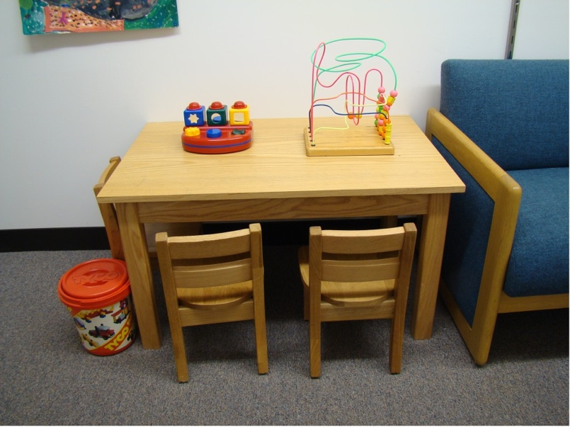
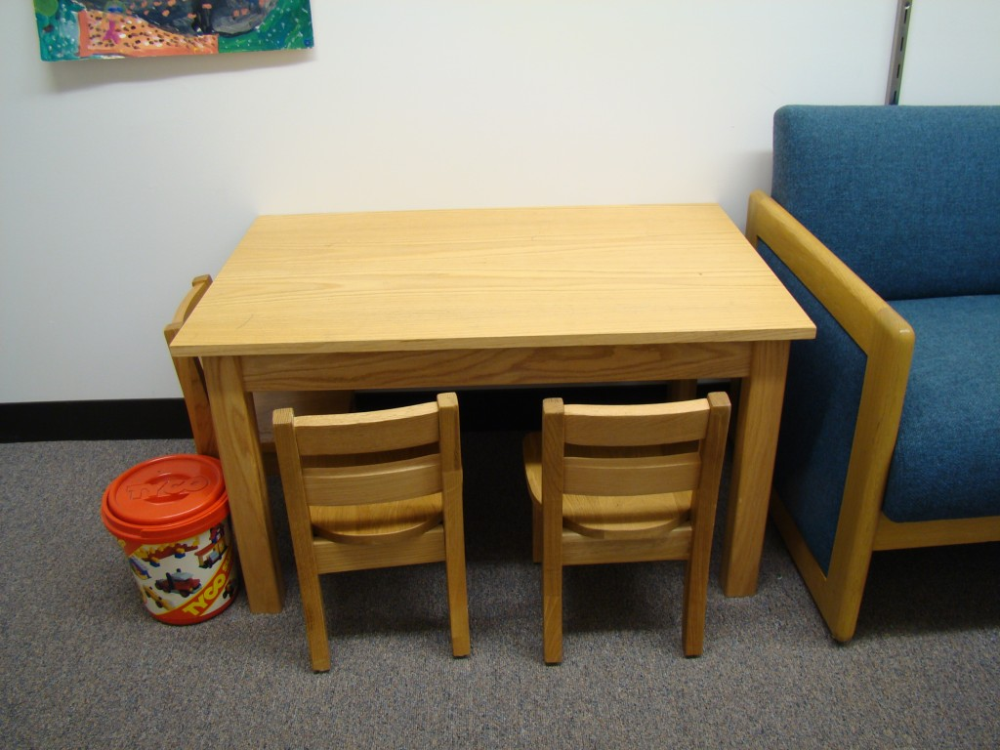
If the designer specifies a foreground image that has some objects
depicted and a background image that is identical, except that those
objects are missing, then in the environment, several things become
possible. One is that the object can be specified as visible or hidden
and be revealed or hidden later as a result of some action or
interaction. In addition, if an object defined this way is dragged with
the mouse, it will appear as if it has been picked up and moved across
the screen. This illusion is created because when the object is dragged,
the location in which it was defined is quickly replaced with the same
region from the background. Note that for an object to be “_takeable_”,
it has to be specifically specified as such in GEMSedit. Otherwise, users
won’t be able to move it with the mouse. However, it could still be
hidden or revealed. Another powerful that that results from using the
on/off design for foreground and background images and specifying an
object as takeable is that it can be dragged a) onto other objects, and
b) into your pockets.

One of the many triggers available for objects is what happens if a
specific other object is dragged onto it. Making an object takeable
allows the designer to create interesting interactive possibilities. For
example, you might specify that if a toy is dragged onto a bin, it
disappears from the table. Thus, allowing users to clean up organize
objects. Programmatically, the object has just be marked as non-visible
as a result of an interaction type action. At the environment level,
several global options can be specified. One is how many (including 0)
pockets will be available. Pockets are icons that show up in the bottom
left corner of the display that look like denim jeans back pockets,
e.g.:

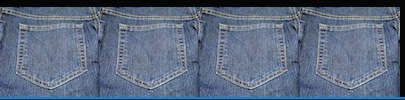
If a takeable object is dragged to a pocket, it will appear as if it is
dragged out of the environment and into the pocket:

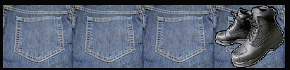
Pockets allow users to collect objects and move them from one view to
another. Right-clicking a pocketed object will cause it to return to
its original location. If you wanted the user to drag the boots into a
box depicted in a view, you couldn’t change the foreground picture so
that it looked like the boots were now in it. However, you could do one
of 2 things: One you could have a depiction of the boots in the box in
the background image and (critically) within the same exact rectangular
space, have a version of the box without the shoes in the foreground
image. This way, dragging the shoes onto the empty box could be made to
result in the box object disappearing, revealing the boots-in-box region
on the background. One possible action in GEMS is to place an image from
the computer as an overlay of sorts on top of the foreground image.
Thus, another approach would be to specify that if the boots are dragged
onto the box object, that area could be covered by a small image just
depicting the boots in the box. Either way, the effect for the user
looks as if they have dragged the boots out of their pocket and into the
box, e.g.:

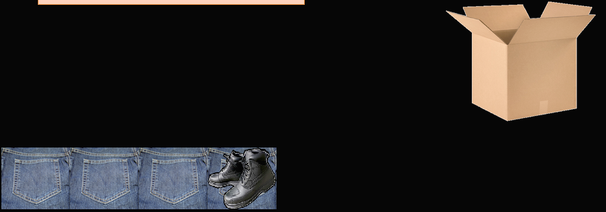
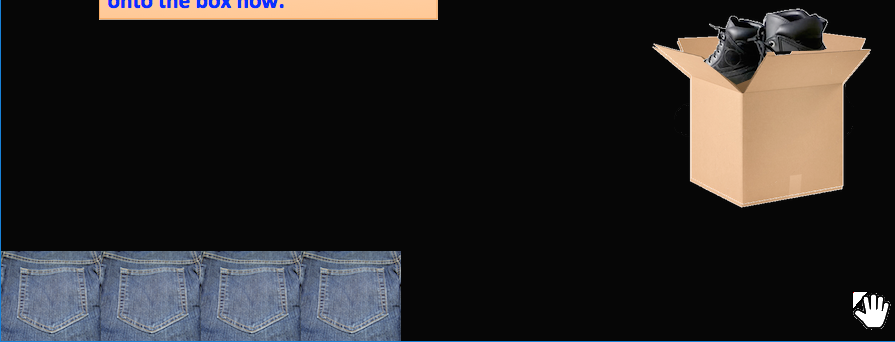
Automatically Portaling. Most often, moving from one view to another
happens a result of some user-initiated action or interaction. However,
portaling can also occur as a result of global timed events, or
view-level timed events. One use for global timed portals may be to
institute a deadline for interaction with a GEMS environment. For
example, maybe you want to take the user to a view with the words TIME’S
UP after 30 minutes. View level timers can be used to make things happen
relative to entering a view. For example, maybe after 2 minutes, if some
action has not been taken by the user, you could show a textbox
containing a clue, or portal to another view. Sometimes we use
view-level timed portaling to quickly move the user through a sequence
of views to establish a crude animation. This can be used to give the
user the sense of moving over a long distance, or be used to establish
the layout of a space. If, each of several views contained a
**ViewTimePassed** trigger set to go off .25 seconds after the view is
entered that fires a **PortalTo** action, then you could fly the user
from one point in a room to another. E.g.:

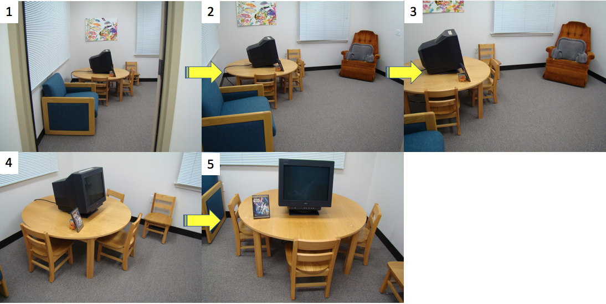
Left-clicking on view #1 could automatically portal you through the
subsequent views until you stopped at view 5. This is animated in a way
that feels as if you are flying from the door, around the room, to the
table.

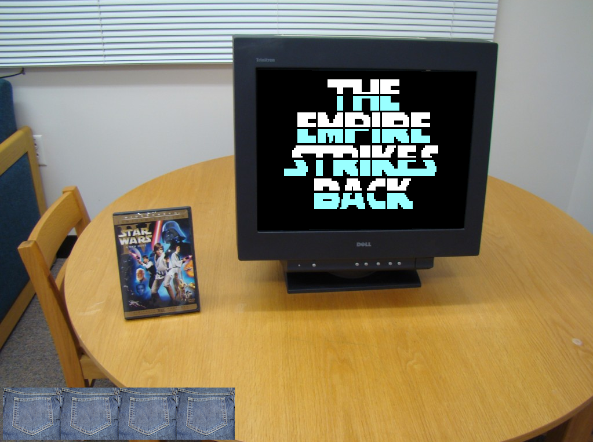
In the test environment depicted above, an interaction is defined in
view 5. If the dvd cover (which is not takeable in this case – we forgot
to take a picture without the dvd) is dragged onto the monitor, a little
video plays. Note that although the dvd is not takeable it is still
**_draggable_**. In GEMSedit, objects have three properties: **Visible**
(whether the object appears), **Takeable** (whether it can be picked up
and pocketed), and **Draggable** (whether it can be dragged for
interactions). An object can be draggable without being takeable – the
downside of this arrangement is that the object will not look as if it
is being dragged, but the interaction will still work.

### Using GEMSedit

**Loading an existing GEMS Environment.** GEMS environments consist of a
folder that contains an environment file (e.g., kidsroom.toml) and
a folder of media (pictures and audio files), named [ENVNAME]\_media,
e.g., kidsroom_media. To open an environment, press the OPEN ICON,
navigate to an environment folder, and choose the environment (.toml) file.

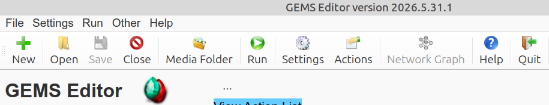
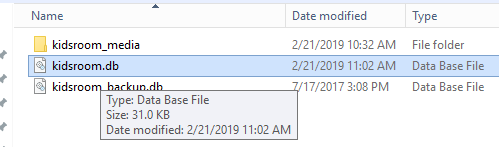
Global Environment Settings. There are several global settings.

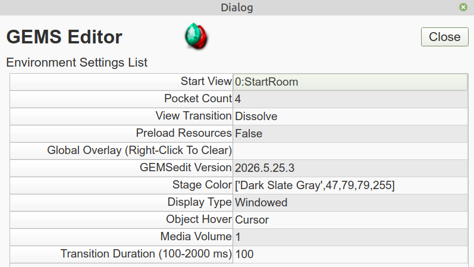
**Start View**: This defines the first view that will be loaded when the
environment starts. You can change this to any existing view in the
environment.

**Pocket Count**: The number of pockets to feature in the environment.

**View Transition**: This allows you to specify how GEMS transitions
from one view to the other. Options include:

- **None**: Instant jump between views
- **Dissolve**: Crossfade/dissolve transition
- **Wipe-Left**: New view wipes in from the left edge
- **Wipe-Right**: New view wipes in from the right edge

**Transition Duration**: Duration in milliseconds for view transitions
(100-2000ms). Default is 400ms. A value of 0 means no transition will
be performed regardless of the View Transition setting.

**Preload Resources**: When enabled, GEMS will pre-generate Text-to-Speech
audio outputs before starting the environment, reducing delays during
runtime when SayText actions are triggered.

**Global Overlay**: If a picture is specified here, it will be overlayed
onto the upper left corner of the environment for **_<u>every</u>_**
view. This cannot be changed while the environment is running and may
have limited use cases. For a flexible overlay, you'll notice that when
designing a view, you can specify a view-level overlay that can be
different from one view to the next. We've used this for a dynamically
updating map of where one is in an environment. E.g.:

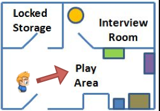

**GEMSedit Version**: This field shows which version of GEMSedit last
saved the environment. It updates automatically and is not user-editable.

**Media Volume**: Sets the overall volume level for any media playback
within GEMSrun (0.0 to 1.0).

**Stage Color**: Hopefully you won't have to deal with this. The size of
the environment is dictated by the **StartView's foreground picture**.
Any subsequent view that uses foreground/background smaller than this
will result in a colored background showing the extent of the area not
used. This setting specifies the color of that region. Make all of your
view images the same size to avoid this situation!

**Display Type**: Can be either Windowed or FullScreen. Windowed mode is
nice for designing because one will also need to manage media files.
However, for a more immersive experience, switch to FullScreen.

**Object Hover**: This dictates what happens when someone hovers over a
region defined as an object. The options are:

- **None**: No visual feedback when hovering
- **ChangeCursor**: Cursor changes to a yellow hand
- **FrameObject**: Yellow rectangle around object boundaries
- **ShowName**: Object name displayed near the object
- **Frame+Cursor**, **Name+Cursor**, **Frame+Name**, **Cursor+Frame+Name**: Combinations of the above

Most of these permutations were created for designing environments, but
ChangeCursor is a good user-facing choice.

---

### Running a GEMS Environment.

To run a loaded environment, just click on the run icon:

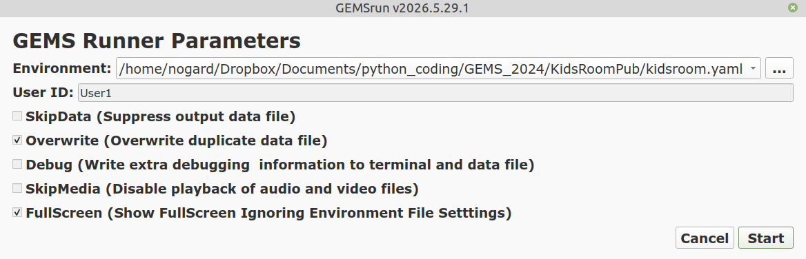
The **Environment File** field is not editable and will be set to
whatever environment is currently loaded into the editor. GEMS is
designed to save data about everything that happens during a run, a user
id can be used to distinguish data from multiple users. If this is left
at its default, it will always use “User1” as the user id. You can
toggle whether to actually save the data and whether to overwrite or
rename an existing data file for a particular user. Media playback can
be disabled when quiet operation is desired. You can also select Debug Mode. This will add a yellow outline to any object with which the user can interact. If the object is large enough, the object name will be visible. In addition, a debug information window can be launched with Ctrl+Shift+I that will show the current status of the environment, the current view, and any currently defined variables. E.g.:

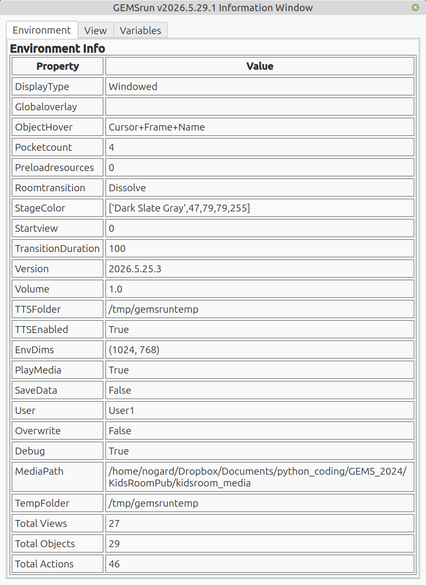
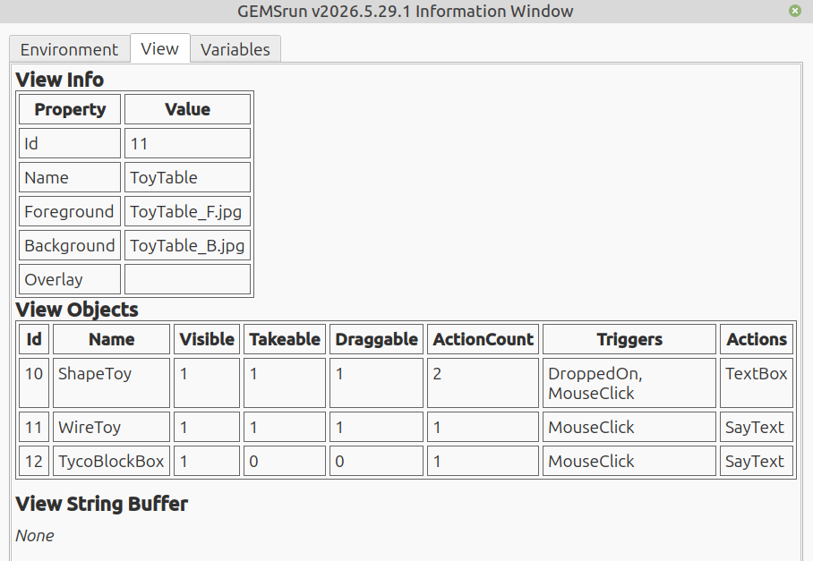
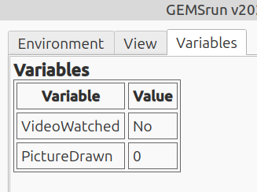

Note that this window is only available when GEMSrun has been launched with Debug Mode enabled.

Finally, press the Launch GEMS Runner button to start. To stop, press
ESCAPE (e.g., in FullScreen Mode) or click the red close-window icon
(e.g., in Windowed Mode).

---

### Creating a New GEMS Environment.

1. Press the NEW button\
   
2. Navigate to where you want the environment folder to be created
   (e.g., Desktop) and type in a name of your project (no extension).
   For example, enter “MyEnvironment” and press **SAVE**.\
   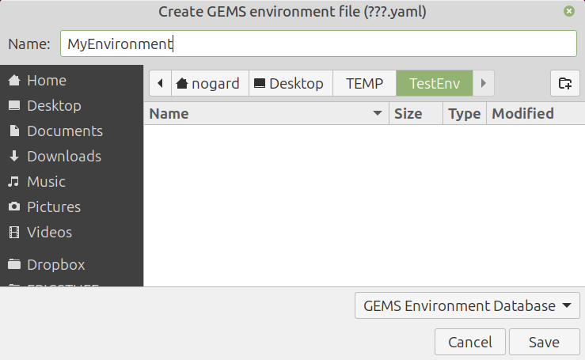
3. You will notice that GEMS creates a new environment with 2 default
   views (StartRoom and EndRoom). A couple of objects and interactions
   have been defined. You can delete these and specify your own
   environment.

4. Click the **MediaFolder** icon to open your media folder.\
   
5. Do not bother the files already here. Some of them are needed for
   GEMS operation. Dump all the images and sound files (e.g., .png or
   .jpg image files, and .mp3 or .ogg audio files. Many formats are
   supported). You will need for your environment here. Then you will
   be ready to stitch them all together to form your environment.

6. I suggest you plan out your environment on paper first. Which views
   will you use and to which other views could a user portal from each
   view.

7. Next it’s time to take pictures. Use a tripod and try to have as
   little difference as possible (i.e., no difference) between the
   camera position when taking foreground and background images for a
   particular view. You want to avoid lighting differences as well –
   keep track of how your own location in the room alters the light.
   Planning is key, if you have to go back later to get another shot,
   the lighting may be very different.

8. If you already know which sounds you want, obtain them or record them
   to .wav or .mp3 and copy them to your media folder as well. Note:
   All pictures and sound files go into the root of your media folder.
   Don’t create any sub-folders.

9. Once you have a plan, and your media, you’re ready to edit your
   environment.

---

### Defining and Editing Views

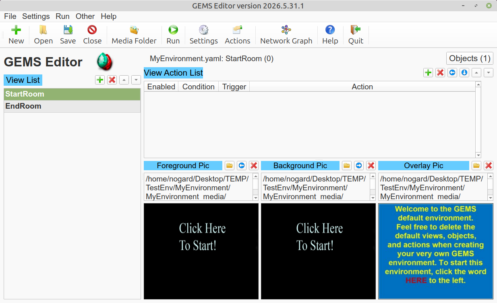

1. These icons allow you to create a new empty view, or delete the
   currently selected view in the list, respectively. Be careful with
   deleting views – this cannot be undone. Also make sure you have
   selected the view you really want to delete. Adding a new view
   requires only a new view name. It is possible to have multiple views
   with the same name – we do not recommend this. The **up/down arrow
   buttons** allow you to reorder views in the list.

2. The folder icon lets you specify a foreground picture from those in
   your media folder. The arrow icon copies the value from the current
   background picture. The red X deletes the current picture entry
   (this does not affect the image file on disk).

3. Same as #2, but for the background picture. The blue arrow will
   make the current background the same image currently used for the
   foreground. **Please ensure that all view foreground and background
   pictures the exact same dimensions or odd things can result. In a
   few use cases, this might be desirable, but not usually.**

4. Select or delete an overlay picture. This picture will be displayed
   relative to the upper left corner of the view. This overlay could
   be as large as the foreground and background pictures, but for many
   use cases, it will be somewhat smaller. E.g., a map, or special
   message.

5. All the windows on this row show a depiction of which image is
   currently selected. If you click on this window, you will be able to
   view a full size version. Click anywhere on the image to close it.

6. Click the green plus to create a new empty action. All cells will
   initially turn red to indicate that not enough information has been
   supplied for it to actually work. This will change when you've
   entered at least a trigger and action (the condition is optional). The
   red X will permanently delete the currently selected action. Please
   be careful that you have selected the appropriate view action and
   that you really want to delete it. This cannot be undone. It may be
   wiser to disable an action than to delete it if you think you may
   want to re-enable it later. Additional action management buttons:

   - **Copy**: Copy actions from another view or object
   - **Duplicate**: Create a copy of the selected action
   - **Up/Down arrows**: Reorder actions in the list (affects execution priority)

7. Clicking on either the Condition, Trigger, Action, or Enabled cells
   allows you to specify their contents for that action. This occurs
   via dialogs that pop up when you click each cell. For example,
   clicking the Condition, Trigger, and Action cells will pop up
   dialogs like these:\
   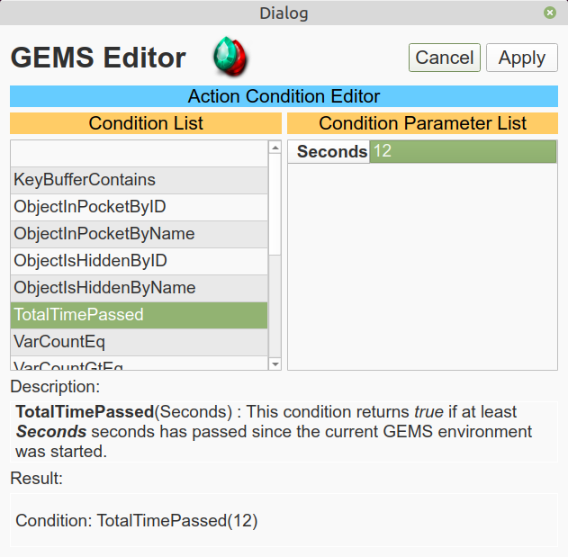 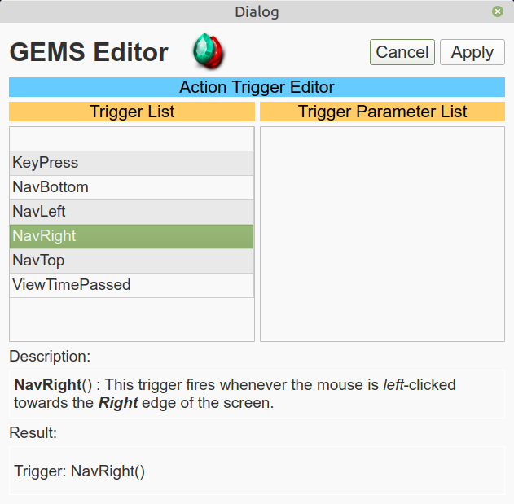 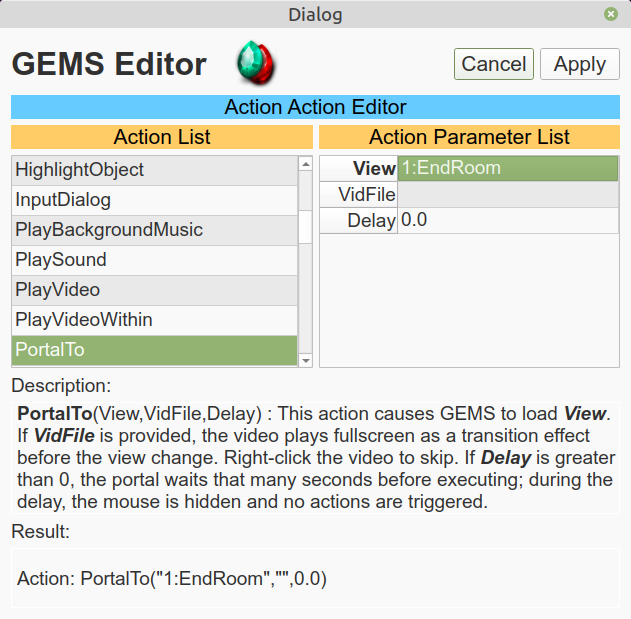
8. This button is used to open a new screen that allows the design and
   specification of objects for this view. Make sure you have specified
   your foreground and background pictures before creating objects.

---

### Defining and Editing View Objects

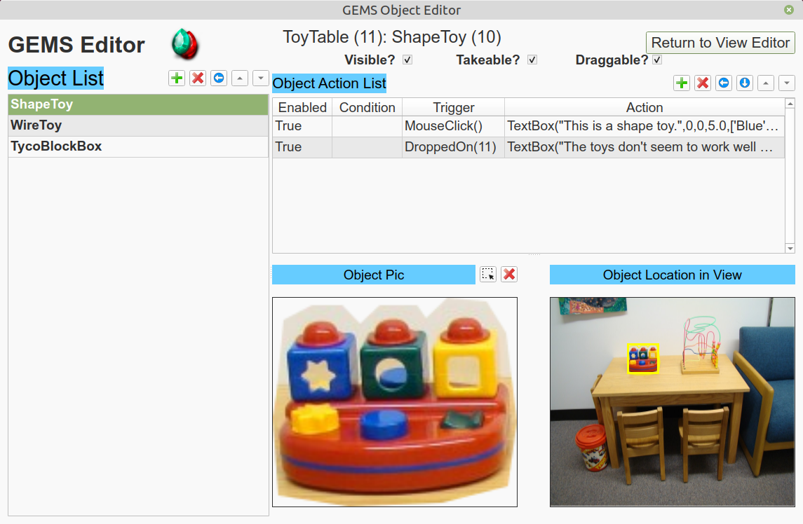

1. Similar to with the view editor, these buttons allow you to add
   define new objects, or remove previous object definitions. Be
   careful, deletions cannot be undone.

2. Objects are simply sub-regions of your existing foreground image.
   Clicking the lasso tool allows you to define your object by clicking
   multiple points to create a **polygon shape**. You can create simple
   rectangles (4 points) or complex irregular shapes. The two image
   regions below #2 and to the right of it (Object Location View) show
   you the selected region in context and in a magnified fashion.
   Pressing the red X button will allow you to clear out the object
   selection.

3. **Visible**: This checkbox determines whether this object will be
   marked as visible, and thus whether it will show up when the
   environment is run. Actions and interactions can toggle this.

4. **Takeable**: This refers to whether or not this object is meant to
   be removed from its default location and potentially dragged to the
   pockets for transport across views. If you define an object as
   takeable, you really should make sure that it is not visible in the
   background image. This will lead to the most natural effect when
   users drag it out of position within the environment. An exception
   to this may be a stack of paper where you want the user to appear to
   have taken a sheet of paper while leaving the stack in place.

5. **Draggable**: This determines whether the object can be dragged for
   interactions (e.g., dragging one object onto another). An object can
   be draggable without being takeable – in this case, the object won't
   visually move when dragged, but interactions will still trigger.

6. Just like at the view level, these buttons allow you to add, remove,
   copy, duplicate, or reorder actions.

7. Just like at the view level (and using the same dialogs shown
   above), this list allows you to manipulate the conditions, triggers,
   and consequences of each defined action.

**Linked Objects**: You can link an object's actions to another object
by naming it with the pattern `ObjectName_[ViewID]_[ObjectID]`. For
example, naming an object `Doorknob_3_7` will cause it to use the
actions defined for object ID 7 in view ID 3. This is useful when
multiple objects should behave identically.

---

### Global Environment Actions

In addition to view-level and object-level actions, you can define
**Global Environment Actions** that run regardless of which view is
currently active. Access these via **Settings → Edit Global Environment
Actions**.

Global actions are useful for:

- Keyboard shortcuts that work throughout the environment
- Time-based events (e.g., ending the environment after 30 minutes)
- Actions that should trigger regardless of the current view

---

### Tools and Utilities

GEMSedit provides several utility tools under the **Other** menu:

**Network Graph**: Displays an interactive visual graph showing how
views are connected through portal actions. This helps you understand
and debug the navigation structure of your environment.

**Clean Media Folder**: Scans your media folder and identifies files
that are not referenced by any view, object, or action. Useful for
removing unused assets and reducing environment size.

**Clear Media Cache**: Clears any cached media files. Use this if you've
updated media files externally and want to ensure GEMSedit loads fresh
copies.

**Validation Report**: Click on the environment filename label (at the
top of the main window) to run validation and view a detailed report.
The label turns orange if there are validation issues (missing images,
broken references, etc.).

---

### View and Object Tags

You can assign color-coded **tags** to views and objects for better
organization. Right-click on a view or object in the list to access
the tag menu. Tags are purely organizational and do not affect runtime
behavior, but they help you keep track of different categories of
views or objects in complex environments.

---

### Keyboard Shortcuts

**GEMSedit:**

- `Ctrl+=` : Increase font size
- `Ctrl+-` : Decrease font size
- `Ctrl+0` : Reset font size to default

**GEMSrun (during environment execution):**

- `Ctrl+Shift+I` : Toggle debug information window (shows current view,
  variables, and environment status) - only available when Debug Mode
  is enabled
- `Ctrl+Shift+X` : Force quit the environment
- `Escape` : Exit the environment (in fullscreen mode)

---

### Other Thoughts

1. **Remember to save your work!** Changes are tracked but not
   automatically saved to disk. Click the **Save** button in the toolbar
   (or use the File menu) to save your environment. When you have unsaved
   changes, the Save button will be enabled. If you close an environment
   with unsaved changes, GEMSedit will prompt you to save.

2. If you want to move around or share your environment, everything
   will be in your project folder. Essentially your xxxxxx.toml file and
   the xxxxxx_media folder.

3. You may need to learn about basic photo editing to manage images
   that are too big, or are of different sizes. Same idea for basic
   audio editing for controlling volume and cropping.

---

## Appendix - GEMS API Reference

This section lists all conditions, triggers, and actions available in GEMS. For detailed parameter descriptions, see the description panel in GEMSedit when selecting each item, or refer to GEMS_Action_Reference.pdf in the GEMSedit Help Menu.

### Conditions

Conditions are optional tests that must be true for an action to execute:

| Condition            | Description                                          |
| -------------------- | ---------------------------------------------------- |
| VarValueIs           | Check if a variable equals a specific value          |
| VarValueIsNot        | Check if a variable does not equal a value           |
| VarExists            | Check if a variable exists                           |
| VarHasString         | Check if a variable contains a substring             |
| VarLacksString       | Check if a variable does not contain a substring     |
| VarCountEq           | Check if variable count equals a number              |
| VarCountGtEq         | Check if variable count is >= a number               |
| VarCountLtEq         | Check if variable count is <= a number               |
| ViewTimePassed       | Check if time has passed since entering current view |
| TotalTimePassed      | Check if time has passed since environment started   |
| KeyBufferContains    | Check if keyboard buffer contains specific text      |
| ObjectInPocketByID   | Check if an object (by ID) is in a pocket            |
| ObjectInPocketByName | Check if an object (by name) is in a pocket          |
| ObjectIsHiddenByID   | Check if an object (by ID) is hidden                 |
| ObjectIsHiddenByName | Check if an object (by name) is hidden               |
| IsShaded             | Check if current object is shaded                    |
| IsNotShaded          | Check if current object is not shaded                |

### Triggers

Triggers define when an action should fire:

| Trigger         | Description                                      |
| --------------- | ------------------------------------------------ |
| MouseClick      | Fires on left-click                              |
| KeyPress        | Fires when a specific key is pressed             |
| DroppedOn       | Fires when another object is dropped on this one |
| ViewTimePassed  | Fires after time passes in current view          |
| TotalTimePassed | Fires after time passes since environment start  |
| NavLeft         | Fires on click near left screen edge             |
| NavRight        | Fires on click near right screen edge            |
| NavTop          | Fires on click near top screen edge              |
| NavBottom       | Fires on click near bottom screen edge           |

### Actions

Actions define what happens when triggered:

**Navigation:**

- PortalTo - Navigate to another view (with optional video transition and delay)
- ChangeViewImages - Change foreground/background images of a view
- Quit - Exit the environment

**Media - Audio:**

- PlaySound - Play an audio file
- StopSound - Stop a specific audio file
- StopAllSounds - Stop all playing audio
- PlayBackgroundMusic - Play looping background music
- StopBackgroundMusic - Stop background music
- SayText - Text-to-speech

**Media - Video:**

- PlayVideo - Play video at a position
- PlayVideoWithin - Play video within an object's bounds
- StopVideo - Stop a specific video
- StopAllVideos - Stop all videos

**Display:**

- ShowImage - Display an image overlay
- ShowImageWithin - Display an image within an object's bounds
- TextBox - Display a text message
- TextDialog - Display a dialog with a message
- InputDialog - Display a dialog that captures user input
- ShowURL - Open a URL in an embedded browser

**Objects:**

- HideObject - Make an object invisible
- ShowObject - Make an object visible
- AllowTake - Make an object takeable
- DisallowTake - Make an object not takeable
- HighlightObject - Draw a highlight around an object
- UnHighlightObject - Remove highlight from an object
- ShadeObject - Fill an object with a semi-transparent color
- UnshadeObject - Remove shading from an object
- ToggleObjectShade - Toggle shading on/off

**Variables:**

- SetVariable - Set a variable to a value
- DelVariable - Delete a variable
- VarIncrease - Increment a numeric variable
- VarDecrease - Decrement a numeric variable
- VarAppend - Append text to a variable

**UI:**

- HideMouse - Hide the mouse cursor
- ShowMouse - Show the mouse cursor
- HidePockets - Hide all pockets
- ShowPockets - Show all pockets
- ClearKeyBuffer - Clear the keyboard input buffer

**System:**

- RunProgram - Execute an external program
